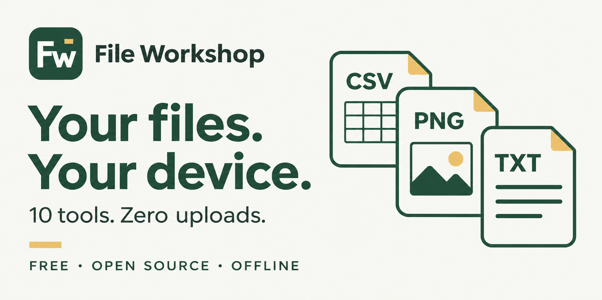

<div align="center">
  <picture>
    <source media="(prefers-color-scheme: dark)" srcset="assets/brand/file-workshop-logo-light.svg">
    
  </picture>

  <h3>Your files. Your device.</h3>
  <p>A free, open-source toolbox for the small file tasks that slow you down.<br>Inspect, clean, compare, convert and organize — right in your browser.</p>

  <p>
    <a href="LICENSE"></a>
    <a href="#privacy"></a>
    <a href="#quick-start"></a>
    <a href="#languages"></a>
    <a href="#faq"></a>
  </p>

  <p><a href="#quick-start"><strong>Get started</strong></a> · <a href="#the-toolbox">Explore the tools</a> · <a href="#self-hosting">Self-host</a> · <a href="README.tr.md">Türkçe</a></p>
</div>



## Why File Workshop?

A CSV opens with broken letters. A form rejects an oversized image. Two versions of a table need comparing. A folder contains the same file under different names.

File Workshop puts those jobs in one place:

- **Local processing.** File contents stay in your browser; no upload service or account.
- **Useful previews.** Check the result before downloading a new copy. Originals are never overwritten.
- **Guides built in.** Every tool has instructions and a walkthrough that highlights its controls.
- **No setup to use it.** Plain HTML, CSS and JavaScript. No backend, AI API key or runtime dependency.

## Quick start

**[Open the web app](https://bekirxxc.github.io/file-workshop/)** · **[Download for Windows (64-bit)](https://github.com/BekirXxC/file-workshop/releases/download/v2.2.0/File-Workshop-2.2.0-Windows-x64.exe)** · **[Download offline HTML](https://github.com/BekirXxC/file-workshop/releases/download/v2.2.0/File-Workshop.html)**

The Windows edition opens in its own window and runs offline without installation, administrator access, Node.js or a browser setup. Download the `.exe`, then double-click it. This community build is unsigned; Windows may show an unknown-publisher notice. Windows 10/11 x64 is supported. The HTML edition also works on other desktop operating systems in a modern browser.

The interface starts in English. A short tip beside the language menu introduces the available languages; choose your language in the top-right corner.

1. Download the project and extract it.
2. Open **`index.html`** in a modern browser.
3. Add a file, choose a tool, review the preview and download the result.

Use **Try sample files** to explore without opening personal documents. No installation or internet connection is needed for the local edition. If you have the single-file release, open **`File-Workshop.html`** instead.

## The toolbox

| Tool | Use it when… | What you get |
| --- | --- | --- |
| **Inspect files** | A filename or extension looks suspicious or incorrect. | File-signature detection, text/byte preview and an optional SHA-256 fingerprint. |
| **Clean CSV** | Letters, separators, empty rows or repeated records need attention. | Encoding and delimiter controls, cleanup preview and UTF-8 export. |
| **Convert image** | An image needs a different size, format or file-size target. | JPEG/PNG/WebP output, proportional resizing, rotation and measured output size. |
| **Clean text** | Pasted text has messy spaces, line endings or JSON formatting. | Line cleanup, sorting, deduplication and JSON formatting that preserves numeric spelling. |
| **Batch rename** | A folder needs consistent filenames. | Prefixes, literal replacement, numbering and collision-safe names in one ZIP. |
| **Text recovery** | Text contains mojibake or hidden Unicode marks. | Reversible encoding repair, invisible-character inspection and opt-in cleanup. |
| **Table comparison** | Two CSV versions have moved rows, reordered columns or changed values. | Key-based added/removed/changed records; ambiguous duplicate IDs are reported separately. |
| **Split a table** | A CSV is too large for the next step in your workflow. | Row-limited parts with optional repeated headers, packaged in a ZIP. |
| **Duplicate finder** | Several filenames may contain the same bytes. | Size/SHA-256 grouping, a report and an archive with one copy per content group. |
| **Batch images** | Several images need the same conversion settings. | Sequential conversion, individual success/failure results and one output ZIP. |

## A few everyday uses

**Prepare an image for an upload form**  
Set maximum dimensions and a target KB, preview the converted image, then check its actual size before downloading.

**Compare an old and a new export**  
Choose a stable ID column. Row order does not matter; the comparison separates additions, removals and changed fields.

**Recover a garbled sentence**  
Preview reversible fixes for text such as `Türkçe`. Inspect invisible characters before removing marks that may be meaningful in a language.

**Split a table for another application**  
Choose the number of data rows per part and repeat the header when needed. The final shorter part is kept.

## Privacy

File contents are processed in tab memory. The application makes **no network requests**, writes no browser storage and uses no analytics, advertising, remote fonts, CDN scripts or external AI services.

Clearing the workspace or refreshing removes files from the application. It does not delete originals or downloaded copies.

Exported images are redrawn from pixels, so source EXIF/GPS fields are not copied. Information visibly printed in an image remains visible. Rename and duplicate ZIPs preserve original file contents, including their existing metadata.

> File detection is not an antivirus or a guarantee that a file is intact. Review results before using or sharing them. See [supported formats and limits](docs/TECHNICAL.md#privacy-and-limits).

## Languages

**19 choices:** English, Spanish, French, German, Portuguese, Russian, Arabic, Chinese, Japanese, Hindi, Turkish, Azerbaijani, Kazakh, Uzbek, Kyrgyz, Turkmen, Tatar, Bashkir and Uyghur.

Translation coverage varies. **◐** marks a partial translation; missing explanations use English. Arabic and Uyghur support right-to-left layouts. Changing language updates the application name and interface, **not your filenames or data**.

See [language coverage](languages.md) for details. Native-speaker improvements are welcome.

## Appearance & guides

Switch between **light and dark mode** using the sun/moon control. Language and appearance choices last for the open session.

Use **How to use** on a tool page for an explanation, or start its three-step walkthrough. The sidebar also opens the guide catalog.

## Self-hosting

File Workshop is a static site. Keep `index.html` and its referenced JS/CSS files together; no application server or build step is required.

For **GitHub Pages**:

1. Upload the extracted project contents to your repository root.
2. Open **Settings → Pages**.
3. Select **Deploy from a branch**, choose your source branch and **`/ (root)`**, then save.

See GitHub's [publishing-source guide](https://docs.github.com/en/pages/getting-started-with-github-pages/configuring-a-publishing-source-for-your-github-pages-site). A host may keep its own access logs; File Workshop does not send file contents to it.

## Development

To build the Windows executable yourself, run `npm ci` followed by `npm run build` inside `desktop/` on Windows. Build dependencies require internet access; the finished application does not. See [desktop/README.md](desktop/README.md).

Node.js **20+** is needed only for tests and the optional portable build. No dependency installation is required.

```sh
npm test
```

```sh
npm run portable
```

The portable build writes `standalone.html` with embedded scripts, styles and matching content-security-policy hashes. It adds no local machine paths, account details or uploaded files.

## FAQ

<details>
<summary><strong>Does it require an AI API key?</strong></summary>

No. The tools use local JavaScript and native browser APIs. There is no AI API integration, subscription or account requirement.

</details>

<details>
<summary><strong>Can it repair any broken file?</strong></summary>

No. File inspection detects supported signatures and possible extension mismatches. Text recovery attempts reversible encoding fixes. It does not repair PDF/Office/archive internals, decrypt files or reconstruct missing data.

</details>

<details>
<summary><strong>Are there processing limits?</strong></summary>

Yes. The workspace accepts up to 100 files, 50 MB per file and 150 MB total. CSV/text tools accept 5 MB. Image and table tools have additional browser-memory and format limits. See the [full limits](docs/TECHNICAL.md#privacy-and-limits).

</details>

<details>
<summary><strong>Are files modified or deleted on my device?</strong></summary>

No. Tools create downloadable copies. The duplicate finder does not delete originals, and batch renaming only changes names inside the new archive.

</details>

## Contributing

Bug reports with small synthetic examples, accessibility fixes and translation improvements are welcome. See [CONTRIBUTING.md](CONTRIBUTING.md).

## License

**MIT** — use, modify and share. See [LICENSE](LICENSE).

---

<div align="center">
  <strong>Less effort. Tidy files.</strong><br>
  Free, open source and built to work locally.
</div>
