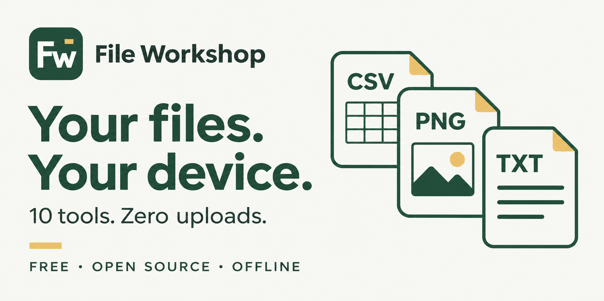

# File Workshop

<picture>
  <source media="(prefers-color-scheme: dark)" srcset="../assets/brand/file-workshop-logo-light.svg">
  
</picture>

A free, offline file toolbox. No account, upload, API key, CDN, analytics, or runtime dependencies. Open **index.html** in a modern browser, or host the folder on GitHub Pages.

[Türkçe temel kullanım](../README.tr.md) · [Language coverage](../languages.md)



## Ten tools

| Tool | What it helps with |
| --- | --- |
| Inspect files | Detect file signatures and extension mismatches, preview text/bytes, calculate SHA-256. Detection is not an antivirus or an integrity guarantee. |
| Clean CSV | Choose encoding/delimiter, remove empty or duplicate rows, preview and export UTF-8 BOM with optional formula protection. |
| Convert image | JPEG, PNG, WebP, fit dimensions, rotate/flip, set quality or target KB, preview actual output. |
| Clean text | Whitespace, line endings, duplicates, Turkish sorting, lossless JSON formatting/minification. Number spelling and duplicate object keys are preserved. |
| Batch rename | Prefixes, literal replacement, numbering, transliteration, collision-safe ZIP downloads. |
| Text recovery | Reverse common reversible mojibake; inspect Unicode direction, joiner, invisible and unusual-space characters before optional cleanup. Missing data cannot be reconstructed. |
| Table comparison | Match CSV records by a unique key even when rows and columns move. Separate added, removed, changed and ambiguous records. Export the differences. |
| Split a table | Split CSV/TSV into row-limited parts, optionally repeat the header, download a ZIP. The final short part is preserved. |
| Duplicate finder | Group files by size and SHA-256. Export a report or one copy per content group. Originals are never deleted. |
| Batch images | Convert supported images sequentially, report individual failures, download successful conversions as one ZIP. |

## Guides, languages and appearance

Every tool has **How to use** instructions and a three-step walkthrough that highlights the controls. The sidebar also opens the guide catalog.

The top-right selector contains **19 language choices: 10 world languages and 9 Turkic languages**, including Turkish and Azerbaijani. Only languages with actual translated interface messages are offered; the former English-only placeholder choices have been removed. English and Turkish have the broadest coverage. Other languages have translated controls and guides, with English fallback for messages that have not yet been translated. **◐** means partial coverage. Translation details and sources are in [languages.md](../languages.md). Translations have not been professionally reviewed.

Arabic and Uyghur layouts support right-to-left reading. File names and file contents are never translated. Use the sun/moon button for light or dark mode. Language and theme choices last for the open session; no browser storage is written.

## Privacy and limits

- Files stay in tab memory. Clearing the workspace or refreshing removes them from the application; it does not delete original or downloaded files.
- No network calls, cookies, persistent storage, tracking, external fonts or model services. A restrictive content security policy blocks connections.
- Exported images are redrawn from pixels; source EXIF/GPS is not copied. Information visible in the image remains visible.
- Rename/duplicate ZIPs retain original file contents, including any metadata already inside those files. Reports contain selected filenames, content hashes, or table differences: review reports before sharing them.
- Workspace: **100 files**, **50 MB per file**, **150 MB total**. CSV/text: **5 MB**, **50,000 rows**, **500 columns**. Batch image output: **150 MB**. Table splitter: **500 parts**.
- Image inputs: **32 megapixels**, **16,384 pixels per side**. SVG, HEIC and TIFF are not converted. Animated images become a single frame. AVIF decoding depends on the browser.
- Target KB uses quality search and may be unreachable; the measured result is shown. PNG ignores quality. ZIP exports store files without compression or encryption.
- Unicode joiners and direction controls can be linguistically necessary. Cleanup is opt-in. Encoding recovery is a reversible heuristic, not a universal repair engine.
- PDF/Office/archive internals are not repaired, extracted or decrypted. A matching file signature does not prove that a file is healthy or safe.
- SHA-256 and clipboard APIs may require HTTPS or localhost in some browsers. Text can always be selected and copied manually.

## Development

Plain HTML/CSS/JavaScript; no installation or build needed to run. Source code contains no personal account details, machine paths or uploaded file data.

Node.js 20+ is used only for tests and the optional single-file build:

```sh
npm test
npm run portable
```

The portable command creates **standalone.html**, embedding all scripts/styles and their CSP hashes. It adds no build timestamp, local path, author account or machine metadata. Only the application is embedded, not the files you have opened in it.

To publish on a static host, keep index.html and its referenced JS/CSS files together at the site root. A GitHub repository can serve these directly through Pages; no backend is required.

## License

MIT. See [LICENSE](../LICENSE).
